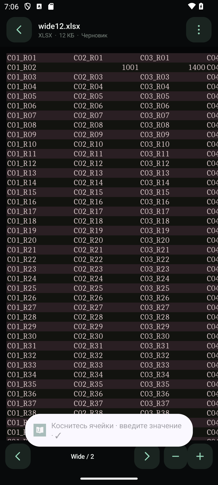

# UniReader

[Скачать APK для Android](https://github.com/dantefq/UniReader/releases/latest/download/UniReader-1.2.1-arm64.apk) · [Все файлы релиза](https://github.com/dantefq/UniReader/releases/tag/v1.2.1)

Текущая версия: **1.2.1**.



Нативный Android-просмотрщик и базовый редактор документов без рекламы, аналитики, регистрации и доступа к интернету. Android 8.0+, ARM64; отдельная x86_64-сборка для эмуляторов. Office — LibreOfficeKit 26.2.6.3, PDF — MuPDF 1.28.5 в отдельном процессе, интерфейс — Java и Android Canvas.

## Обновление

Установите **UniReader-1.2.1-arm64.apk** поверх QuietRead / «Тихо». Идентификатор `app.quietread` и подпись сохранены: удалять старую версию не нужно. Название в Android — UniReader. Локальные документы, закладки и черновики сохраняются. Старые PDF-черновики Draw автоматически переводятся в PDF при открытии; исходный файл остаётся нетронутым.

## Исправление клавиатуры в 1.2.1

В режиме редактирования одно касание текста теперь открывает поле ввода и экранную клавиатуру для Word/Writer, RTF, TXT, презентаций Impress/PowerPoint и текста Draw, включая поддерживаемые шаблоны и совместимые расширения. Кнопка «Текст» также остаётся доступна. Двойное касание в текстовом документе выделяет слово для замены.

До 1.2.1 автоматический ввод был подключён только к ячейкам и PDF, а остальные типы требовали отдельного нажатия «Текст». Исправлен общий обработчик касания; для надписей на слайдах и в Draw сразу активируется редактирование текста объекта.

Вызов клавиатуры ждёт готовности окна и фокуса поля. Повторные запросы прекращаются при успешном открытии или закрытии диалога. Быстрые повторные касания не создают несколько окон ввода. В поиске и адресе ячейки клавиатура тоже открывается автоматически.

Это не OCR: у изображения или сканированной страницы может отсутствовать текстовый слой. В PDF для скана используется инструмент добавления надписи.

## Что изменилось в 1.2

- Почти чёрная тема: фон #080A0B, поверхности #15191B, светлые надписи и мятный акцент. Меню, диалоги, поля и кнопки оформлены в одном стиле. Системный выбор файла и клавиатуру оформляет Android.
- При масштабировании старые плитки остаются видимыми до готовности новых. Во время pinch-жеста растягивается один снимок (до 3 МиБ), чёткие плитки запрашиваются после окончания жеста. Очередь ограничена двумя запросами, устаревшие разрешения пропускаются. Обновление документа также сохраняет предыдущую отрисовку до замены. Общий кэш плиток ограничен 32 МиБ.
- Исправлено положение документа относительно точки pinch-жеста. При появлении клавиатуры выбранная ячейка остаётся в видимой области.
- У таблиц постоянная строка адреса и значения/формулы. Касание ячейки открывает клавиатуру; `✓` или клавиша подтверждения применяет значение. Поле адреса поддерживает `B2` и диапазоны `B2:C10`. Формулы начинаются с `=`. Новая компактная панель: просмотр, отмена, повтор, оформление, сохранение.
- Исправлен путь Excel → PDF: выбор разметки, подготовка печатной копии и сохранение всего содержимого без изменения оригинальной книги.
- PDF редактируется напрямую, без импорта страниц в Draw. Сохранение копирует полный граф PDF-объектов, сохраняя формы, ссылки, закладки, размеры, CropBox и поворот страниц. История отмены не меняется при экспорте/автосохранении.
- PDF и Office работают в разных процессах: их нативные обработчики сигналов конфликтовали при переходе из PDF в Office. Растровые результаты передаются через Binder. При закрытии PDF освобождается нативный кэш.
- Черновики сохраняются после 4 секунд без изменений; повторные сохранения объединяются. Кэш шрифтов Office теперь записывается в доступную папку приложения.

## Excel → PDF

Меню документа → **Сохранить / конвертировать → PDF**:

1. **Все столбцы по ширине страницы** — рекомендуемый режим для широкой таблицы. Одна страница по горизонтали, автоматическое продолжение по вертикали. Берётся вся используемая область, включая ячейки за исходной областью печати. Очень широкая таблица даст мелкий шрифт.
2. **Каждый лист целиком на одной странице** — один PDF-лист на лист книги. Размер страницы соответствует содержимому; это удобно для просмотра с увеличением, но не обязательно для печати на A4.
3. **Как в настройках печати файла** — сохраняет исходные области печати и разбиение. Если в исходной книге область печати ограничена, часть ячеек в этот PDF не попадёт.

## Редактирование PDF

Откройте PDF → меню ⋮ → **Редактировать**. По умолчанию касание строки открывает замену текста с клавиатурой. Можно изменить размер шрифта. Удаляется настоящий текст выбранной строки; изображения и графика под ней не закрашиваются.

Кнопка **Инструмент PDF**:

- заменить строку текста;
- добавить надпись в выбранном месте;
- выделить строку;
- удалить строку.

Доступны отмена, повтор, локальный PDF-черновик и экспорт в PDF. В текущем сеансе отмена сохраняется после автосохранения. Между запусками история отмены не хранится.

Это редактор строк и надписей, а не настольная система перевёрстки PDF. Новый текст не передвигает соседние блоки. Вставляемый текст использует встроенный Liberation Sans, поддерживает кириллицу, сохраняет базовую точку, размер, цвет и направление выбранной строки; смешанное форматирование строки не воспроизводится. Сканы без текстового слоя позволяют добавлять надписи, но OCR отсутствует. Конструктор форм, редактирование изображений PDF, PDF → DOCX/XLSX и сохранение действительности цифровых подписей не реализованы. Подписанный документ после изменения требует новой подписи.

## Office и конвертация

Word/Writer: DOC, DOCX, DOCM, DOT/DOTX/DOTM, RTF, ODT/OTT/FODT, SXW/STW.

Excel/Calc: XLS/XLSX/XLSM/XLSB, XLT/XLTX/XLTM, ODS/OTS/FODS, SXC/STC, CSV/TSV.

PowerPoint/Impress: PPT/PPTX/PPTM, PPS/PPSX/PPSM, POT/POTX/POTM, ODP/OTP/FODP, SXI/STI.

Draw: ODG/OTG/FODG, SXD/STD. Дополнительно PDF, TXT, SVG. Тестовый HTML в этой сборке движка не открылся; прежнее упоминание HTML/XHTML не означает гарантированной поддержки импорта. Поддержка зависит от фильтров движка; защищённые паролем файлы пока не поддерживаются.

| Тип | Экспорт |
|---|---|
| Word/Writer/текст | PDF, DOCX, DOC, ODT, RTF, TXT UTF-8, EPUB, FODT, OTT, HTML с ресурсами в ZIP, PNG, JPEG |
| Excel/Calc | PDF, XLSX, XLS, ODS, CSV текущего листа, FODS, OTS, HTML ZIP, PNG, JPEG |
| PowerPoint/Impress | PDF, PPTX, PPT, ODP, FODP, OTP, PNG, JPEG |
| Draw | PDF, ODG, FODG, SVG, PNG, JPEG |
| PDF | PDF, PNG/JPEG текущей страницы, PNG всех страниц в ZIP |

PNG/JPEG ограничены стороной 4096 пикселей и площадью 8 млн пикселей. CSV сохраняет текущий лист без оформления, TXT — только текст. EPUB доступен для экспорта, но не для чтения. Office-конвертация может менять вёрстку и шрифты.

Изменения хранятся в закрытом черновике ODT/ODS/ODP/ODG/PDF, исходник не перезаписывается. Экспорт сначала готовится локально, затем записывается в выбранное место через системный диалог. Перед удалением приложения экспортируйте нужные черновики: удаление приложения удаляет его закрытую библиотеку. Внезапное завершение процесса может потерять последние ещё не сохранённые изменения.

## Сборка и исходники

Нужны JDK 17+, Android SDK 35, Gradle wrapper 8.7; сборка проверена с JDK 21. AGP 8.6.1.

```powershell
./tools/fetch-engine.ps1
./gradlew.bat :app:assembleArm64Release :app:assembleEmulatorRelease
```

LibreOffice-файлы исключены из исходного ZIP из-за размера. `fetch-engine.ps1` получает точные официальные APK F-Droid 26.2.6.3 (131 для arm64, 129 для x86_64), проверяет закреплённые SHA256 и извлекает неизменённые библиотеки. `configure-engine.ps1` применяет настройки приложения. **Ресурсы LibreOffice внутри APK должны оставаться несжатыми**; Gradle уже настроен соответствующим образом.

Официальный MuPDF AAR включён в `app/libs/fitz-1.28.5.aar`, SHA256 `e6887a242882cdd2dce062430bb46b6727513e3eb94e222255cc1a37db7a7d8e`. Его соответствующие исходники и Android-сборочные файлы находятся в `third_party/` полного исходного ZIP из раздела Releases. Для пересборки AAR распакуйте Android wrapper, поместите исходники MuPDF в его `libmupdf/` и следуйте `README`/`Makefile` wrapper (AGP 8.5.2, NDK 28.2.13676358). Подробности в `SOURCE-NOTICE.md`.

Ключи подписи не входят в исходный ZIP. Собственная сборка с другой подписью не устанавливается поверх опубликованной без удаления её данных.

## Проверки и ограничения

Результаты исправления — в `TEST-REPORT-1.2.1.md`, основные проверки 1.2 — в `TEST-REPORT-1.2.md`. Проверено на Android 14 x86_64 в эмуляторе; ARM64 APK собран и проверен по структуре/подписи, физический телефон не подключался для проверки. Это не обещание одинаковой скорости или идеальной совместимости со всеми документами.

Макросы, PDF JavaScript и OLE Automation отключены. Интернет-разрешения нет. Используется стандартный LibreOffice-режим встроенных диаграмм.

Приложение и новые изменения — AGPL 3.0 или новее. LibreOffice JNI и библиотеки, шрифты и прочие компоненты сохраняют свои исходные лицензии; см. `LICENSE*` и `NOTICE-QuietRead.txt` в assets. Это самостоятельный продукт, не официальный продукт LibreOffice или Artifex.
